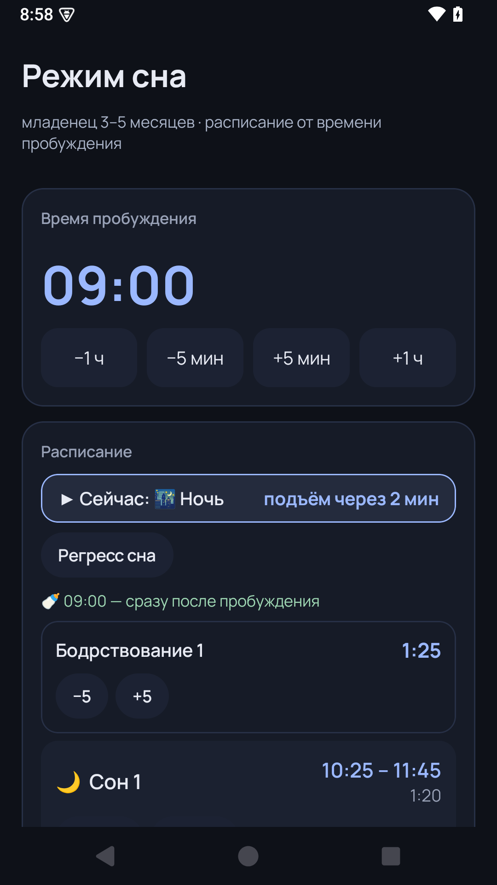
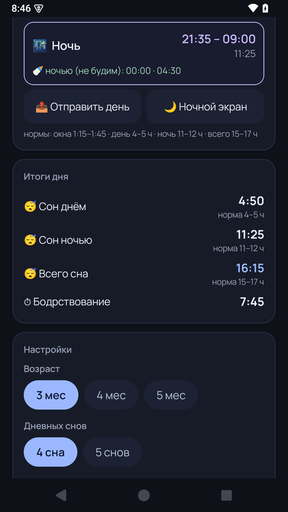

# BaSleep 🌙

Калькулятор режима сна для младенца 3–5 месяцев. Задаёшь время утреннего
пробуждения — приложение собирает весь день: окна бодрствования, дневные сны,
кормления, ночь и итоги с проверкой по возрастным нормам.

Тёмная тема, шрифт Manrope, всё на русском. Личное семейное приложение
(первый пользователь — сын, 3 месяца 🍼).

## Возможности

- **Расписание от пробуждения**: встал на 15 минут раньше — весь день
  сдвигается на 15 минут, окна не ломаются.
- **Правки по факту ±5 мин**: сон кончился раньше/позже плана — поправь,
  следующее бодрствование авто-компенсируется (сон короче → окно короче,
  до ±15 мин), остаток дня пересчитается.
- **Редактируемые бодрствования** ±5 мин с жёстким коридором по возрасту
  и предупреждениями о перегуле.
- **Кормления по часам**: 7 времён (по умолчанию 00:00/04:30/09:00/12:00/
  15:00/18:00/21:00), показываются между снами; наезд кормления на сон —
  предупреждение.
- **Схемы по числу снов**: 3 мес → 4/5 снов, 4 мес → 4/3, 5 мес → 3
  (база для 3 мес — правила нашего консультанта по сну).
- **▶ Сейчас**: подсветка текущего этапа и «укладывание через N мин».
- **Регресс сна** одной кнопкой: все бодрствования −10 мин, ранний отбой.
- **Итоги дня**: сон днём/ночью/всего с нормами и суммарное бодрствование.
- **Ночной экран**: огромный отсчёт до подъёма, экран не гаснет.
- **Экспорт дня в Telegram** структурированным текстом.
- **Виджет** «следующее событие» на рабочий стол.
- Всё сохраняется между запусками; все времена кратны 5 минутам;
  Σбодрствований + Σснов + ночь = 24 часа (проверяется юнит-тестами).

## Скриншоты

| Главное расписание | Итоги дня |
|---|---|
|  |  |

## Сборка

```bash
./gradlew :app:testDebugUnitTest :app:assembleDebug
# APK: app/build/outputs/apk/debug/app-debug.apk
```

Требования: JDK 17, Android SDK 35. Перед сборкой прогоняются 25
юнит-тестов движка расписания.

## Стек

Kotlin · Jetpack Compose (Material 3) · Min SDK 26 (Android 8+).

Шрифт [Manrope](https://fonts.google.com/specimen/Manrope) — SIL Open Font License.
