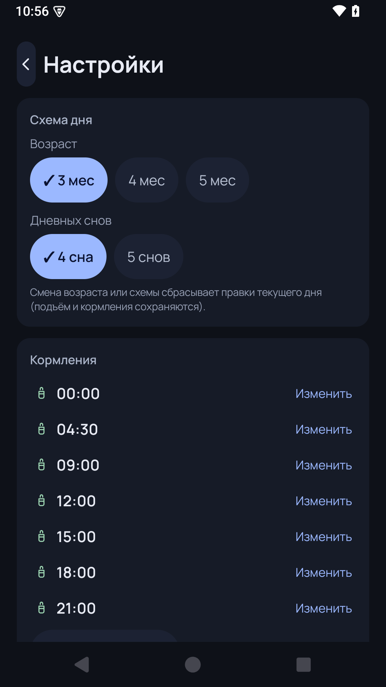

# BaSleep 🌙

Калькулятор режима сна для младенца 3–5 месяцев. Задаёшь время утреннего
пробуждения — приложение собирает весь день: ближайшее событие, окна
бодрствования, дневные сны, кормления, ночь и итоги с проверкой по
возрастным нормам.

Тёмная тема, шрифт Manrope, единый векторный набор иконок, всё на русском.
Личное семейное приложение.

## Возможности

- **Главный экран «Сегодня»**: ближайшее событие с отсчётом («Сон 1 по плану
  до 11:45 · через 50 мин»), компактная временная лента со сворачиваемыми
  прошедшими событиями, итоги «По плану», закреплённая нижняя панель
  (ночной экран, поделиться).
- **Правки по факту ±5 мин**: сон короче/длиннее плана — следующее
  бодрствование авто-компенсируется (до ±15 мин), остаток дня
  пересчитывается; происхождение правки подписано (ручная / авто / режим).
- **Редактируемые бодрствования** ±5 мин с клэмпом на входе (жёсткий
  коридор 1:10–1:50 для 3 мес, без скрытого запаса на границе).
- **Кормления по часам**: 7 времён, ±5 мин и ±1 ч, нейтральные подписи
  («до подъёма», «после отбоя», «совпадает со Сном N»).
- **Схемы по числу снов**: 3 мес → 4/5 снов, 4 мес → 4/3, 5 мес → 3.
- **Регресс сна** одной кнопкой в настройках (все окна −10 мин).
- **«Начать новый день»** с отменой; все сбросы точны и обратимы.
- **Ночной экран** с большим отсчётом; **виджет** «следующее событие»;
  **экспорт дня в Telegram** структурированным текстом.
- Доступность: зоны нажатия от 48 dp, semantics для TalkBack, выбор не
  только цветом (✓). Всё сохраняется; времена кратны 5 минутам;
  Σбодрствований + Σснов + ночь = 24 ч (проверяется тестами).

## Скриншоты

| Главный экран | Настройки |
|---|---|
|  |  |

## Сборка

```bash
./gradlew :app:testDebugUnitTest :app:assembleDebug
# APK: app/build/outputs/apk/debug/app-debug.apk
```

Требования: JDK 17, Android SDK 35. Перед сборкой прогоняются 25
юнит-тестов движка расписания.

## Стек

Kotlin · Jetpack Compose (Material 3) · Min SDK 26 (Android 8+).

Шрифт [Manrope](https://fonts.google.com/specimen/Manrope) — SIL Open Font License.
